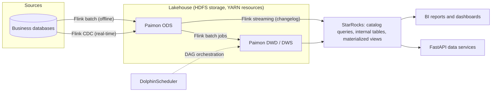

*Industry project at my current employer. The description below has been generalized; no internal code, data, configuration or screenshots are published.*

## Overview

The company's data warehouse was built on Kettle and DataX for ETL and MySQL for both storage and queries. The project migrated it to a lakehouse architecture:

- **Apache Flink** for both batch and streaming computation, including Flink CDC for change capture
- **Apache Paimon** for lakehouse tables
- **StarRocks** as the OLAP query engine
- **DolphinScheduler** for dependency-driven workflow orchestration

The platform runs on a self-hosted cluster of 9 servers.

## Problem and motivation

The legacy setup had problems in four layers at once:

1. **Scheduling had no logical dependencies.** Jobs started at fixed times. If an upstream job failed or ran late, downstream jobs still ran and produced wrong or empty results that had to be found and rerun by hand.
2. **Low-code ETL was hard to maintain.** Complex logic was spread across many Kettle drag-and-drop nodes, and historical documentation was missing.
3. **MySQL was doing analytical work.** An OLTP database was handling large joins and aggregations, which made offline jobs slow and failure-prone.
4. **No real-time capability.** The business needed a few real-time operational dashboards, and the legacy pipeline could only deliver T+1 data.

Because the problems spanned scheduling, computation, storage and querying, and a new real-time requirement had appeared, the team chose a full migration over local optimization.

## Architecture

The diagram below is a **simplified illustration** of the main data flows. It is not a complete production topology.

- **Offline path (most data, T+1):** Flink batch jobs load source data into Paimon and transform it layer by layer (ODS → DWD → DWS/DWM → ADS). DolphinScheduler triggers each job when its upstream dependencies finish.
- **Real-time path (a few tables):** Flink CDC captures changes into Paimon primary-key tables, and a Flink streaming job consumes the changelog into StarRocks for the operational dashboards.
- **Serving:** StarRocks queries Paimon through a catalog for low-frequency detail data, uses internal tables for high-frequency subject tables, and uses asynchronous materialized views for pre-aggregation. A FastAPI layer exposes subject-level data to other internal systems, with authentication, rate limiting, query timeouts and row limits.

## Technical decisions

| Decision | Choice | Main reason | Cost or risk |
| --- | --- | --- | --- |
| Table format | Apache Paimon | Native Flink integration, primary-key upserts, changelog consumption, unified batch and streaming | Small files and compaction need ongoing attention |
| OLAP engine | StarRocks | Can query lake tables directly and also accelerate dashboards with internal tables and materialized views | Extra data copies; consistency between internal and external tables must be managed |
| Compute | Flink (replacing Kettle and DataX) | One engine for batch and streaming, with CDC support | Learning cost; batch ecosystem is smaller than some alternatives |
| Scheduling | DolphinScheduler | DAG dependencies, retries and alerting | Self-hosted operation |
| Migration strategy | Top-down, with legacy and new pipelines running in parallel | Only migrate pipelines that reports actually use; every step can be checked | Running both pipelines doubles resource and maintenance cost during the transition |

**Paimon table conventions.** Business tables are mostly primary-key tables keyed on a business-unique field, partitioned by year-month, and use dynamic bucketing. The primary key includes the partition field.

**Migration process.** Starting from each report in the application layer, I traced its dependencies down through the warehouse layers and re-implemented the historical Kettle logic. The legacy and new pipelines then ran in parallel. Record-level differences were analysed and confirmed with business users before switching over. While tracing the legacy logic, I documented the processing logic and metric definitions of each table. These documents were later reused as a knowledge source for the [Light-ChatBI]({{ '/projects/light-chatbi-data-agent/' | relative_url }}) semantic layer.

## My contributions

Two people worked on the warehouse technology: my team lead and I.

- **My team lead** set the technical direction, approved designs, and handled business requirements and scheduling.
- **I** carried out the technical research and wrote the proposals, deployed and operated the platform components (HDFS/YARN, Flink, Paimon, StarRocks, DolphinScheduler), developed the data pipelines from the ODS layer to the ADS layer, and built the FastAPI data services.
- **Others:** dedicated BI developers built reports on top of the application layer, and metric definitions were agreed with business stakeholders.

## Engineering challenges

**Undocumented legacy logic.** Kettle jobs had to be opened node by node to recover their logic. The top-down approach limited this work to pipelines that reports still depended on.

**A heap out-of-memory error in a large batch write.** A Flink batch job inserting about 105 GB of data into a Paimon primary-key table (partitioned by year-month, dynamic buckets) failed with a heap out-of-memory error in the writer. I increased the source scan parallelism and the sink write parallelism from 4 to 8, which spread the write load across more subtasks. I reran the job and checked that the source and target record counts matched. My working explanation is that each writer subtask had too many partition and bucket write buffers to hold at once. I did not confirm this through memory profiling. This fixed one job; it was not a general solution to memory issues on the platform.

## Results and limitations

Measured over a one-month observation period after the new system went live, compared with update tasks of the same scale before the migration:

- **Daily warehouse update time:** the total time for the daily T+1 update of the whole warehouse fell from over 4 hours to about 2 hours (roughly 50% shorter).
- **Task failure rate:** measured as the share of failed scheduled task instances, it fell from about 10% to about 7%.
- **Real-time data:** a small number of operational dashboards now receive near-real-time data, which the legacy pipeline could not provide.

The time savings come from several changes together: dependency-triggered scheduling instead of fixed-time waiting, Flink batch jobs replacing Kettle jobs, and merging duplicated processing found during the migration. Their individual contributions were not measured separately. These results come from one migration in one environment and should not be read as general benchmarks of the tools involved.

**Known limitations.** Monitoring is spread across several systems, so diagnosing faults means checking multiple interfaces. The small-file problem was addressed after it appeared rather than planned for at table design time. End-to-end real-time latency is not yet monitored continuously. If I rebuilt the platform, I would add unified observability (data latency, task status, file counts and query performance) first.

## Technologies

Apache Flink (batch, streaming, Flink CDC) · Apache Paimon · StarRocks · DolphinScheduler · Hadoop HDFS / YARN · FastAPI · SQL · Python · Legacy stack: Kettle, DataX, MySQL
