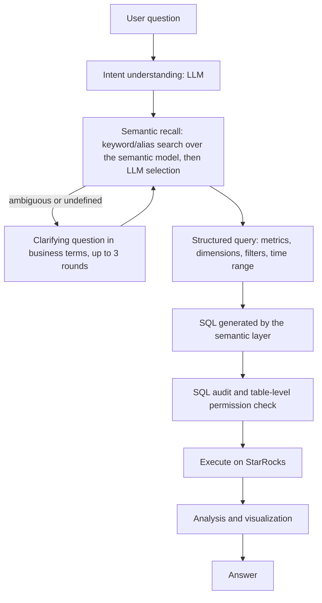

*Internal industry project, started in March 2026. It is not open source. The description below has been generalized; no internal code, data, prompts or configuration are published.*

## Overview

Light-ChatBI lets business users ask data questions in natural language and receive query results, analysis and charts. It runs on StarRocks and uses a privately deployed open-weight language model (Qwen3.6 27B, 4-bit quantized, hosted on the company's own GPU server), so data does not leave the company.

The main design idea is to **keep the language model away from free-form SQL**. The model interprets the question and chooses metrics, dimensions, filters and time ranges from a semantic layer, and the SQL is then generated deterministically.

## Problem and motivation

Business users frequently need ad-hoc data that fixed reports do not cover. Previously, each request went through the data team: request, SQL development, execution, analysis. With limited staff, a request could wait in the queue for about 2–3 hours. The project's **target** is to bring a typical supported request down to under 10 minutes. This is a design goal and has not been measured as an achieved result.

## Architecture

The diagram below is a **simplified illustration** of the current request flow.

An outer control loop (a "harness loop" I wrote) records the state of each request, retries failed steps, and limits each request to three iterations. Requests to the model go through an inference task queue because the single GPU can serve very few requests at once. Logins and queries are audited.

## Technical decisions

**Semantic layer instead of free-form text-to-SQL.** The first version gave the model the table DDL and let it write SQL. The SQL usually executed but often answered the wrong question: the model picked the wrong metric definition, time field or join path. Making the model choose from defined metrics and dimensions trades coverage for correctness. The system can only answer questions that the semantic layer covers, but for business data, a wrong answer is worse than no answer.

**How the semantic layer evolved.**

| Version | Approach |
| --- | --- |
| V0 | The LLM writes SQL directly from table DDL. |
| V1 | A custom semantic layer defined in three kinds of YAML files (tables and fields, join relations, metric definitions). The LLM selects semantic elements, and an AST-based assembler generates SQL deterministically. Business-language clarification, aliases and synonyms, and permission, audit and task-queue components were added. |
| V2 (current) | Migrated to the open-source **Cube Core** semantic layer. The LLM outputs a structured Cube query (measures, dimensions, filters, time range) and Cube compiles it to SQL. The reasons for migrating were a more systematic model, lower development cost and easier maintenance. |

**Keyword recall before vector search.** With around 300 metrics, keyword and alias search followed by LLM selection was enough for most recall and is easier to debug than vector retrieval. A knowledge-base index plays a supporting role.

**A custom control loop instead of a graph-orchestration framework.** The workflow is fixed and uses few tools, so a small custom loop gave direct control over state, retries, iteration limits and clarification.

## My contributions

- I designed and implemented the system: the agent workflow and control loop, the V1 semantic layer and AST-based SQL assembly, the migration to Cube Core, the clarification design, table-level permissions, auditing and the inference task queue.
- The system builds on existing components that I did not develop: the open-weight language model, Cube Core and StarRocks.
- Metric definitions were worked out with business stakeholders. The evaluation questions came from the requesting business team, which also confirmed correctness.

## Engineering challenges

- **Ambiguous business metrics.** The same metric name can have different definitions in different contexts. The fix had two parts: make each queryable metric as unique as possible and add business aliases, then ask the user in business terms when candidates remain ambiguous.
- **Recall failures from missing aliases.** Some questions failed because a business term had no alias in the semantic layer. These were fixed by adding aliases and synonyms.
- **Clarification design.** An early version showed raw database field names in clarifying questions, which users could not understand. Clarifications were rewritten in business language.
- **Limited inference capacity.** A 27B model quantized to 4 bits runs on a single 24 GB GPU, so concurrency and context length are tight. Latency is noticeably higher when chain-of-thought reasoning is enabled.

## Results and limitations

- **Scope:** about 300 metrics, used by about 20 internal business users.
- **SQL accuracy on an acceptance set:** on the same set of 200+ real questions provided by the requesting business team, covering the data domains the system supports, accuracy rose from **58%** (V0, LLM writing SQL from DDL) to **100%** (V1, custom semantic layer, measured when V1 went live).

**How to read the accuracy figure:**

- An answer counted as correct if the business side confirmed it **and** its result matched a reference SQL query.
- Questions answered correctly **after a clarification round** also counted as correct. How many questions needed clarification was not recorded.
- The question set defines the supported scope and was also used during development. The 100% therefore shows reliability within that acceptance set; it is not evidence of generalization to new questions.
- The 100% was measured on V1, **before** the migration to Cube Core. No equivalent figure is reported here for the current version.

No figures are reported for user-time savings, cost savings or user satisfaction.

## Technologies

Python · StarRocks · Cube Core · YAML semantic models · SQL AST processing · ReAct-style agent workflow · Qwen3.6 27B (4-bit quantized, private deployment) · Text-to-SQL
